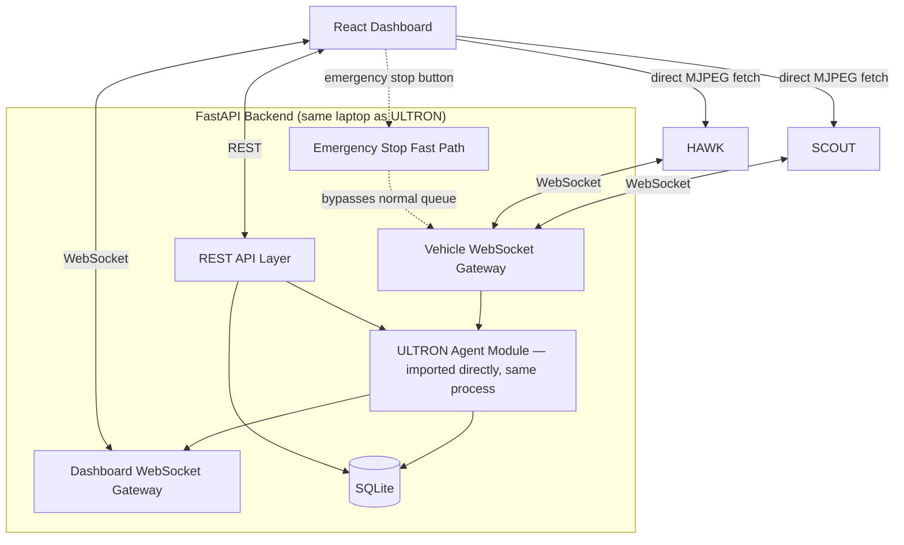
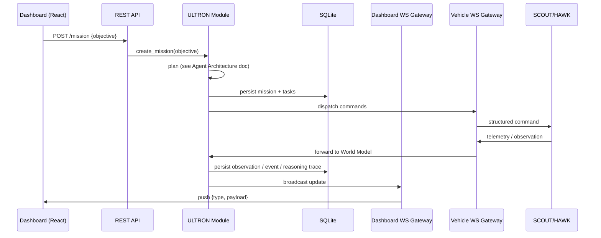
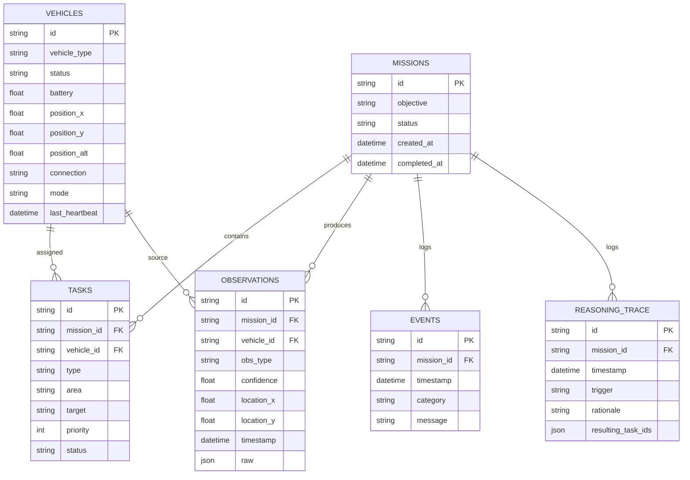
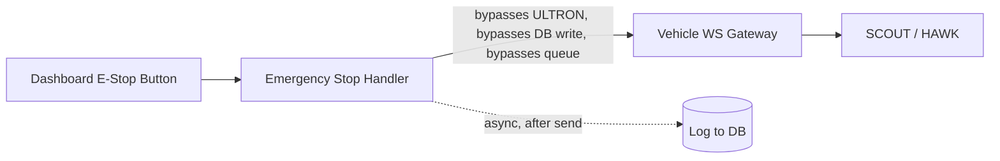

# OPERATION SHADOW

## Backend & Frontend Architecture

**Version:** 1.0 **Scope:** The FastAPI service layer that connects ULTRON's agent logic (see ULTRON Agent Architecture doc) to both vehicles and to the React dashboard, plus the dashboard itself. Does not repeat vehicle hardware/wiring (Hardware & IoT doc) or ULTRON's planning/replanning internals (Agent Architecture doc) — this document is about the plumbing and the UI that sit around them.

---

## 1. Purpose & Scope

Backend and frontend run on the same laptop as ULTRON (TRD v2.0 §1) — this document treats "backend" as the FastAPI process that hosts ULTRON's agent module, talks to both vehicles over WebSocket, persists state to a database, and serves the dashboard. "Frontend" is the React app the operator/judges actually look at.

Three questions this document answers:

1. How does a vehicle's telemetry end up rendered on screen within a few hundred milliseconds?
2. What's actually stored, where, and in what shape?
3. What's the one thing on this whole page that must never be slow or blocked — the emergency stop — and how is that guaranteed?

---

## 2. High-Level System Diagram



Two things worth calling out immediately, because they shape everything below:

- **ULTRON's agent module runs in-process with the backend**, not as a separate service reached over the network — it's imported and called directly. This avoids an entire class of "is the agent service up" failure modes for zero cost, since they're already on the same laptop.
- **Camera feeds bypass the backend entirely.** The dashboard fetches SCOUT's and HAWK's MJPEG streams directly from the vehicles (see §8), rather than relaying frames through the backend. Relaying video through an already-busy process adds latency and load for no benefit at this scale.

---

## 3. Backend Module Structure

```text
backend/
└── fastapi/
    ├── main.py
    ├── api/
    │   ├── mission.py        # POST /mission, GET /mission/{id}, GET /mission/{id}/replay
    │   ├── vehicle.py        # GET/POST /vehicle/{id}/*
    │   ├── events.py         # GET /events
    │   ├── map.py             # GET /map (static floor-plan config)
    │   └── emergency.py        # POST /emergency-stop
    ├── websocket/
    │   ├── vehicle_gateway.py   # handles SCOUT01 / HAWK01 connections
    │   └── dashboard_gateway.py # handles React client connections, broadcasts updates
    ├── db/
    │   ├── models.py
    │   └── session.py
    ├── core/
    │   ├── config.py
    │   └── security.py         # shared-secret token for vehicle connections
    └── services/
        ├── mission_service.py  # wraps calls into the ULTRON agent module
        ├── vehicle_service.py
        └── event_service.py
```

This mirrors the repository layout already fixed in TRD v2.0 §26 — `backend/fastapi/` there is exactly this tree.

---

## 4. Real-Time Data Flow



**The dashboard never polls for routine updates.** Telemetry, event-log entries, and reasoning-trace entries all arrive as pushes over the dashboard WebSocket. REST is reserved for actions the operator initiates (submit a mission, toggle simulated mode, request replay data, emergency stop) — this keeps the near-real-time requirement (PRD §5.1) achievable without the dashboard hammering the backend on a poll interval.

---

## 5. WebSocket Design

### 5.1 Vehicle Gateway (`vehicle_gateway.py`)

- One persistent connection per vehicle (`SCOUT01`, `HAWK01`), authenticated with a shared-secret token set at boot (§9) — this is a private local network, but a hackathon venue is a public space, and an unauthenticated WebSocket accepting "telemetry" from anything that connects is an easy, avoidable mistake.
- Inbound: telemetry (every heartbeat, per Hardware/IoT doc §5.2) and structured observations.
- Outbound: structured commands only, matching the schema fixed in TRD v2.0 §7 — the gateway does not accept or forward arbitrary text to a vehicle.
- Heartbeat timeout handling lives here: if a vehicle's expected heartbeat is missed beyond the threshold (Hardware/IoT doc §5.2), the gateway marks that vehicle `UNKNOWN` in the World Model, which is what the Agent's failure-handling logic (TRD §21) reacts to — the gateway doesn't decide what to do about it, it just reports state accurately.

### 5.2 Dashboard Gateway (`dashboard_gateway.py`)

- Broadcasts to all connected dashboard clients (in practice, one — the operator's laptop screen — but designed to support a second read-only viewer without changes).
- Message envelope:

```json
{ "type": "telemetry" | "event" | "reasoning_trace" | "mission_status", "payload": { ... } }
```

- On client connect, the gateway sends a full current-state snapshot (current mission, both vehicles' latest telemetry, recent event log) before switching to incremental pushes — this is what makes a dashboard refresh (or a judge's laptop joining as a second viewer) show correct state immediately instead of a blank screen waiting for the next event.

---

## 6. Database Schema



SQLite is sufficient at this scale (TRD v2.0 §27) — one operator, one mission running at a time, modest write volume even at a 200–500ms telemetry heartbeat. `VEHICLES.mode` (`real` / `simulated`) is what the Simulated Vehicle Mode toggle (Agent Architecture doc §13) actually flips.

---

## 7. REST API Contract

| Endpoint | Method | Request | Response |
| --- | --- | --- | --- |
| `/mission` | POST | `{ "objective": "string" }` | `{ "mission_id": "M001" }` |
| `/mission/{id}` | GET | — | Full mission state (objective, tasks, status) |
| `/mission/{id}/replay` | GET | — | Ordered timeline of events + reasoning-trace entries for the scrubber UI |
| `/vehicle/{id}/status` | GET | — | Current vehicle state from the World Model |
| `/vehicle/{id}/sensors` | GET | — | Latest raw telemetry |
| `/vehicle/{id}/observations` | GET | — | Observations reported by that vehicle this mission |
| `/vehicle/{id}/command` | POST | Structured command (TRD §7 schema) | Ack — **for manual override/testing only**; ULTRON dispatches commands internally during a normal run, this endpoint exists for bench testing and operator override |
| `/vehicle/{id}/simulate` | POST | `{ "enabled": true }` | Ack — flips `VEHICLES.mode` |
| `/events` | GET | `?mission_id=` | Event log, chronological |
| `/map` | GET | — | Static floor-plan config (room boundaries, fixed waypoints) for the dashboard's SVG map |
| `/emergency-stop` | POST | `{ "vehicle_id": "ALL" \| "SCOUT01" \| "HAWK01" }` | Ack — see §10 for why this path is special |

---

## 8. Frontend Architecture

### 8.1 Component Structure

```text
dashboard/react/
├── src/
│   ├── App.jsx
│   ├── components/
│   │   ├── MissionPanel.jsx
│   │   ├── FloorMap.jsx           # SVG-based, not a geo-mapping library
│   │   ├── CameraFeed.jsx         # switchable SCOUT/HAWK MJPEG view
│   │   ├── VehicleStatusCard.jsx  # battery, connection, current task
│   │   ├── EventLog.jsx
│   │   ├── ReasoningTracePanel.jsx
│   │   ├── MissionReplayScrubber.jsx
│   │   ├── SimulatedModeToggle.jsx
│   │   └── EmergencyStopButton.jsx
│   ├── hooks/
│   │   ├── useDashboardSocket.js  # single WebSocket connection, dispatches by message type
│   │   └── useMissionState.js
│   ├── state/
│   │   └── store.js               # lightweight state (Context+reducer, or Zustand)
│   └── api/
│       └── client.js              # REST calls
```

### 8.2 Why an SVG floor map, not a mapping library

The demo environment is a small, fixed, indoor space with known dimensions (Hardware/IoT doc §11 assumes x/y coordinates, not GPS). Pulling in Leaflet/Mapbox for this is solving a problem that doesn't exist here and adds an external-tile dependency that has no reason to work reliably on a venue network. A simple SVG or `<canvas>` rendering of the known floor plan (`GET /map`), with SCOUT/HAWK rendered as markers at their `position.x, position.y`, is faster to build, has zero external dependency, and is easier to overlay with hazard/target markers and the HAWK geofence boundary.

### 8.3 Camera Feeds

SCOUT's and HAWK's companion links each run a lightweight MJPEG HTTP stream (Hardware/IoT doc §4.2 gives HAWK's companion link this role; SCOUT's Pi does the same for its camera). The `CameraFeed` component points an `` tag directly at whichever vehicle's stream is selected — no video passes through the FastAPI backend. This keeps the backend's job limited to structured data, and avoids adding video-relay latency onto the same process that's also running ULTRON's planning calls.

### 8.4 State Management

A single WebSocket connection (`useDashboardSocket`) receives all pushes and updates a small central store — mission status, both vehicles' latest telemetry, the event log array, the reasoning-trace array. Given the actual state surface here is modest (two vehicles, one mission, a handful of arrays), React Context + a reducer is enough; reaching for Redux or a heavier state library adds ceremony this scope doesn't need. Zustand is a reasonable lighter-weight alternative if the team prefers it, but is not necessary.

### 8.5 Mission Replay Scrubber

Fetches `/mission/{id}/replay` once, after a run completes, and renders the ordered event/reasoning-trace timeline as a scrubbable list — clicking an entry shows the World Model snapshot at that point (plan before / plan after, per PRD §5.2). This is read-only and post-hoc; it does not need to be live-updating, which keeps it simple to build in Week 3–4.

---

## 9. Security Considerations

This runs on an isolated local network for a demo (Hardware/IoT doc §5.1), not a production deployment — security effort should be proportionate, but not zero, since a hackathon venue is a public space with other devices on nearby networks:

- **Shared-secret token for vehicle WebSocket connections** — set at boot from a config file, checked on connect. Prevents an unrelated device from connecting and injecting fake telemetry or commands.
- **Dashboard access** is local-only (the operator's own laptop, same machine as the backend, or a second viewer on the same private access point) — no external exposure, no need for a full auth system.
- **`/vehicle/{id}/command`** (manual override endpoint, §7) should require the same shared-secret token — it's the one REST endpoint that can directly move a vehicle, so it shouldn't be reachable by anything that merely joined the Wi-Fi network.
- **No sensitive data at stake** — no user accounts, no PII — so this is about preventing interference with the demo, not data protection.

---

## 10. The Emergency Stop Fast Path

This deserves its own section because it's the one part of the whole backend that must never be subject to the normal request pipeline's latency, queuing, or failure modes.



- `POST /emergency-stop` sends the STOP command **directly** through the Vehicle WebSocket Gateway, not through ULTRON's planning/validation pipeline (Agent Architecture doc §11) and not waiting on a database write to complete first. Logging the event to the database happens *after* the command is already sent, never before.
- This is the one place in the whole system where "always validate before sending" (the rule everywhere else) is deliberately not the rule — a STOP command is always safe to send immediately, so there's nothing to validate that's worth the delay.
- On the hardware side, this is backed up by the vehicle-local kill switch (Hardware/IoT doc §3.2) and HAWK's onboard failsafes (Hardware/IoT doc §4.2/§8) — the software e-stop is the fast, convenient path; the physical/onboard ones are the guaranteed path if software or Wi-Fi itself is the thing failing.

---

## 11. Latency Budget

| Path | Target |
| --- | --- |
| Vehicle telemetry → dashboard render | \< 300ms end to end (fits inside the 200–500ms heartbeat interval from Hardware/IoT doc §5.2) |
| Dashboard button press → REST call → ULTRON action initiated | \< 200ms (excludes any LLM planning/replanning call itself, which has its own timeout budget per Agent Architecture doc §4) |
| Emergency stop press → command sent to vehicle | \< 100ms (fast path, §10) |
| Camera feed | Not backend-mediated (§8.3) — budget governed by the vehicle's own MJPEG stream and Wi-Fi conditions, not the API layer |

These are targets to test against (§13), not guarantees — measure them for real on the actual venue network during Week 3 rehearsal, not just on a home Wi-Fi network during development.

---

## 12. Testing & Validation Plan

| Test | What it checks |
| --- | --- |
| WebSocket reconnect handling (frontend) | Dashboard recovers cleanly and re-syncs full state if its connection drops and reconnects mid-mission |
| Backend load test (2 vehicles + 1 dashboard client) | No dropped messages or growing latency under sustained heartbeat + telemetry load |
| Emergency-stop latency test | Measured time from button press to command received by a vehicle, under realistic network conditions, repeated multiple times |
| DB write throughput | Confirm SQLite keeps up with the heartbeat + observation write rate without blocking the request path (should be a non-issue at this scale, but verify once rather than assume) |
| Replay scrubber accuracy | Confirm the replay timeline matches the actual live event order from a real rehearsal run |
| Camera feed reliability under Wi-Fi load | Confirm MJPEG streams stay usable while telemetry/commands are also active on the same network |
| Full dashboard smoke test on venue network | All panels populate correctly on a cold load and stay in sync through one full rehearsed mission |

---

## 13. Backend & Frontend Build Schedule

```mermaid
gantt
    dateFormat YYYY-MM-DD
    title Operation Shadow — Backend & Frontend Build Schedule
    section Week 1 (Oct 1-7)
    FastAPI skeleton + DB schema         :a1, 2026-10-01, 3d
    REST endpoints (mission, vehicle)    :a2, 2026-10-03, 3d
    Vehicle WS gateway stub              :a3, 2026-10-04, 2d
    section Week 2 (Oct 8-14)
    Real vehicle WS integration          :b1, 2026-10-08, 3d
    Dashboard WS gateway + push model    :b2, 2026-10-09, 3d
    React shell: map, status cards       :b3, 2026-10-08, 4d
    Camera feed component (MJPEG)        :b4, 2026-10-12, 2d
    section Week 3 (Oct 15-21)
    Event log + reasoning-trace panel    :c1, 2026-10-15, 2d
    Mission replay backend + scrubber UI :c2, 2026-10-17, 3d
    Emergency-stop fast path             :crit, c3, 2026-10-15, 1d
    Full dashboard integration test      :c4, 2026-10-20, 2d
    section Week 4 (Oct 22-31)
    Simulated-mode toggle UI             :d1, 2026-10-22, 2d
    Latency/load testing on venue-like network :d2, 2026-10-24, 2d
    Polish + bug fixing (freeze ~Oct 25) :crit, d3, 2026-10-25, 3d
    Rehearsal support + fixes            :d4, 2026-10-28, 4d
```

---

## 14. Risk Register (Backend & Frontend Specific)

| Risk | Likelihood | Impact | Mitigation |
| --- | --- | --- | --- |
| Dashboard falls out of sync after a reconnect | Medium | Medium — confusing mid-demo | Full-state snapshot on connect (§5.2), tested explicitly (§12) |
| Camera stream competes with telemetry for Wi-Fi bandwidth | Medium | Medium | Direct-to-vehicle MJPEG (§8.3) rather than backend relay; test under load (§12) |
| Emergency stop delayed by a busy request queue | Low if built correctly, High impact if not | High | Dedicated fast path bypassing ULTRON/DB (§10) — this is the one place the normal pipeline is intentionally skipped |
| Replay scrubber scope creep (trying to make it live-updating) | Medium | Low-Medium (time sink, not safety) | Explicitly scoped as read-only/post-hoc (§8.5) |
| SQLite contention under concurrent writes | Low at this scale | Low | Verified once under load test (§12) rather than assumed |
| Frontend state drifts from backend truth under rapid replanning events | Low-Medium | Medium — visibly wrong dashboard during the demo's key moment | Single source of truth is always the backend/World Model; frontend never computes derived mission state locally, only renders what it's pushed |

---

This completes the four-document architecture set for Operation Shadow: **PRD v2.0**, **TRD v2.0**, **Hardware & IoT**, **ULTRON Agent**, and this **Backend & Frontend** document. Together they cover product scope, system-level technical design, physical build, agent internals, and the service/UI layer connecting all of it.